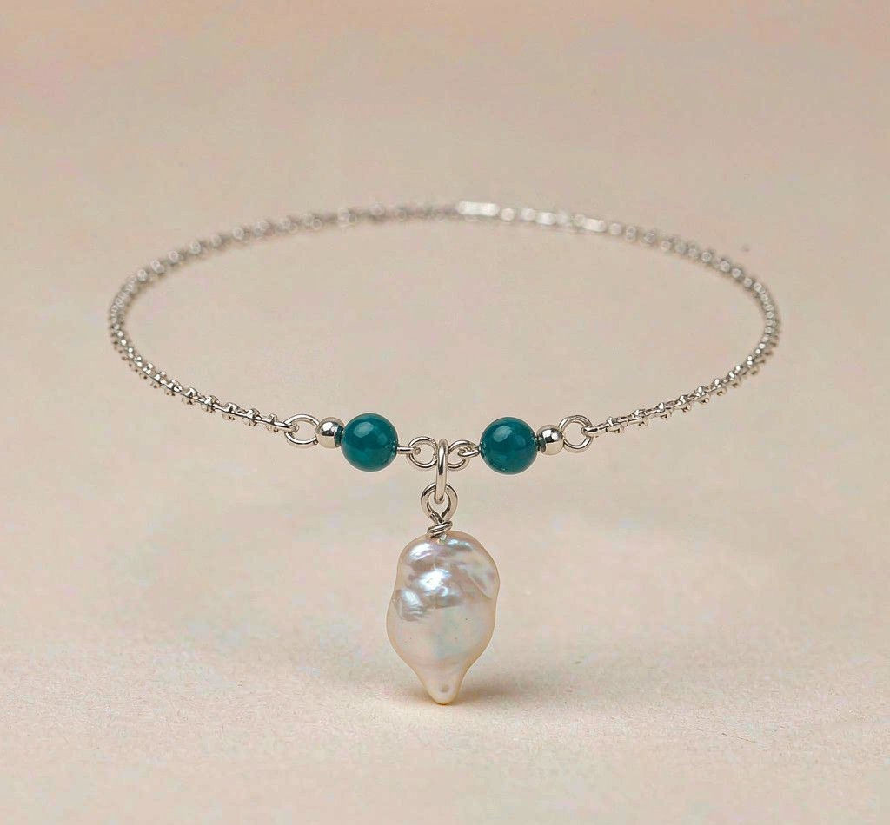
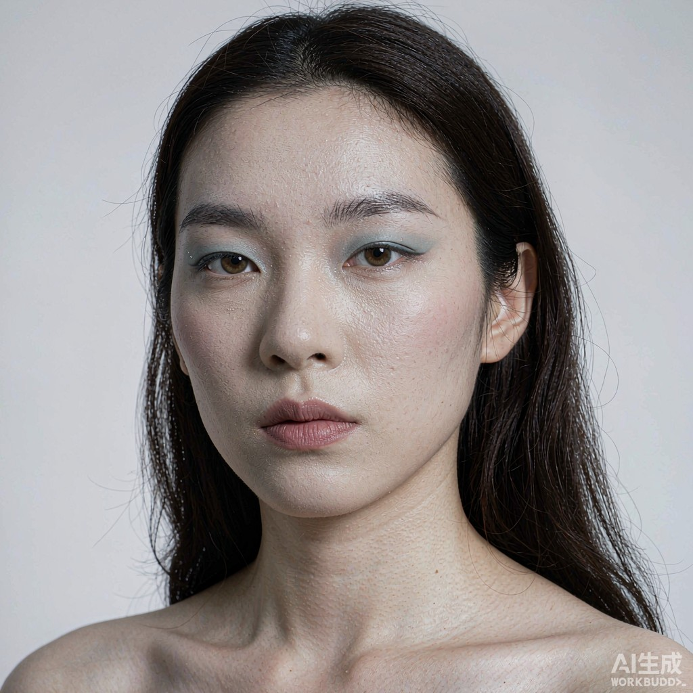
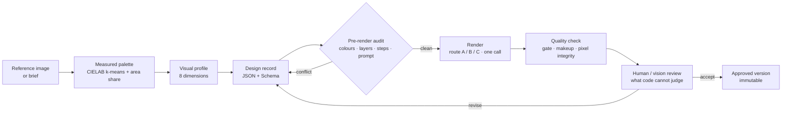
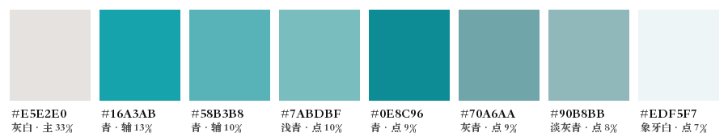
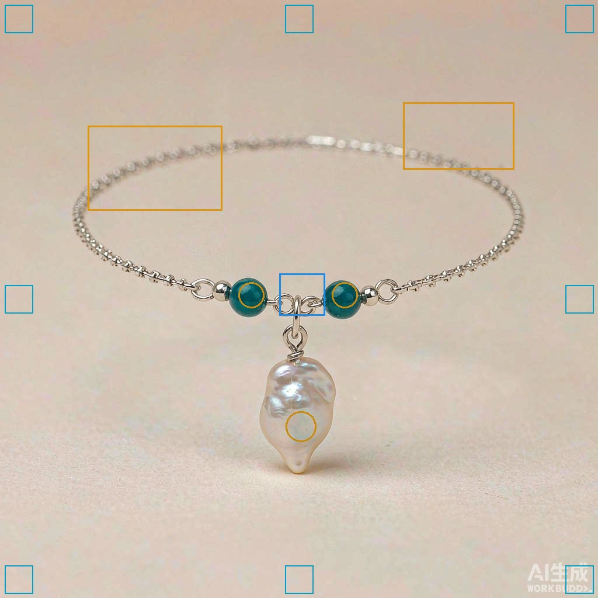
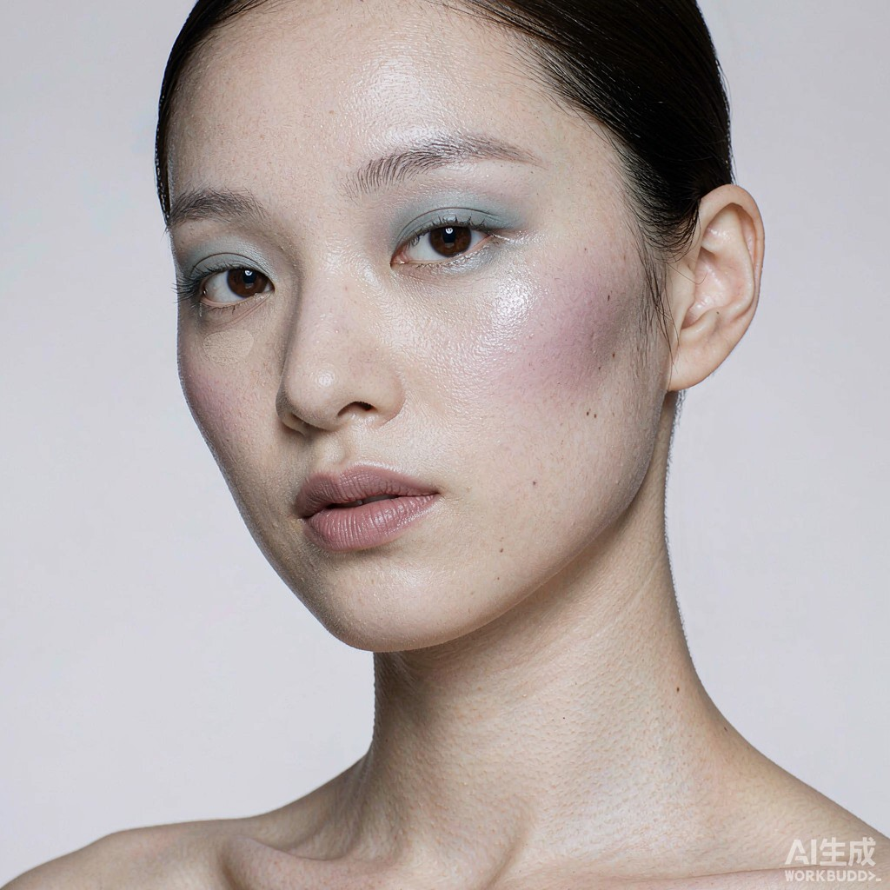
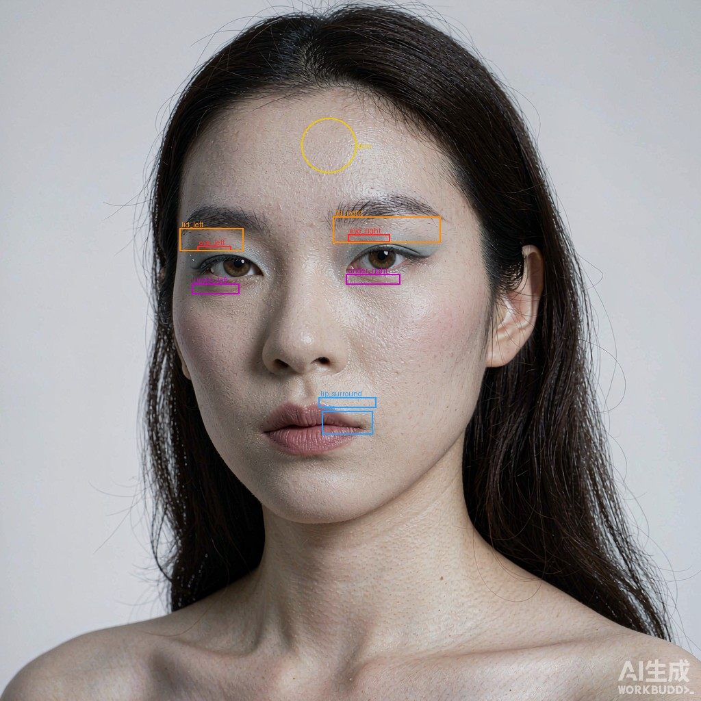
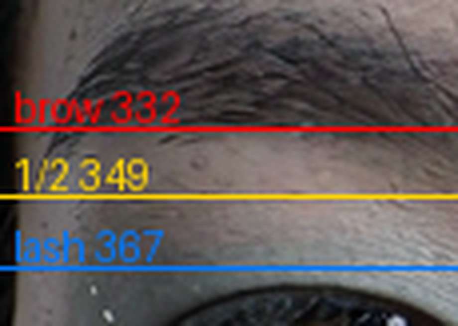
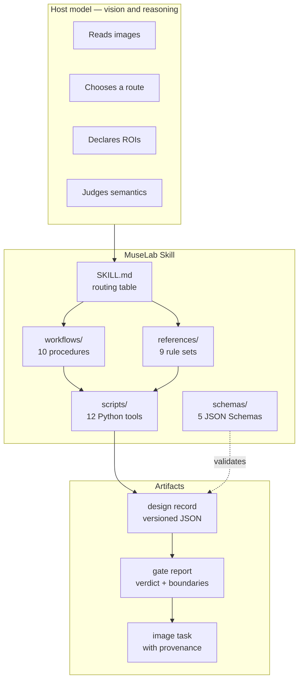

<div align="center">

# MuseLab

**Creative Inspiration Lab**

### From Visual Inspiration to Structured Creative Workflows

A reference photo holds colour, structure and intent. Almost none of it survives a hand-written prompt.<br>
MuseLab measures the image, writes it down as a versioned design record, renders from that record,
and checks the render against it — including saying out loud what it cannot check.

`Python 3.9+` · `WorkBuddy / Claude Skill` · `CIELAB k-means` · `JSON Schema` · `MIT`

**v1.3.1** — research prototype · **[简体中文](README.zh-CN.md)** · [Demos](demos/README.md) · [Validation](docs/VALIDATION.md)

</div>

<p align="center">
  
  
</p>

<p align="center">
<sub><b>AI-generated concept renders — not photographs of real products or people.</b><br>
Left: watermark cropped for layout, the watermarked original is <code>demos/images/03_jewelry_concept_ai.jpg</code>.
Right: host-tool watermark visible.</sub>
</p>

---

## 1. Overview

MuseLab is a modular workflow that turns visual references into **structured, auditable creative designs**.
It ships as a Skill — a routing table, JSON Schemas, deterministic Python tools and domain rules that a
host model loads on demand — with two implemented design domains: **jewellery** and **makeup**.

The problem it addresses is narrow and practical. AI design work usually begins with an image and ends
with a picture. Everything in between — what colour was actually in the photo, which layer is current,
whether the render obeyed the brief — is left in prose, and prose rots. MuseLab puts a machine-readable
design record in that gap, so each of those questions has an answer that can be inspected.

| | Capability | What it does |
|---|---|---|
| **01** | **Visual Analysis** | Measures real pixels: CIELAB k-means palettes with per-cluster area shares, plus an eight-dimension visual profile. Every value is either measured or explicitly marked as estimated. |
| **02** | **Creative Translation** | Converts that data into a domain design record — jewellery structure and material list, or a nine-layer makeup look with application steps — validated against a JSON Schema. |
| **03** | **Controlled Generation** | Renders from the record, versions every change, audits the record for internal contradiction *before* spending a render, and checks the output afterwards. |

**What MuseLab is not.** It is not an image generator, and not a prompt library. The generator is a
dependency; the work here sits on both sides of it. It is also not an autonomous agent or a multi-agent
platform: the model makes judgement calls, the scripts make measurements, and neither is allowed to
claim the other's work.

## 2. Why MuseLab

Three failures show up again and again in AI-assisted design work. MuseLab was built as a response to
each of them, in this order.

| Failure | What goes wrong | What MuseLab does instead |
|---|---|---|
| **The reference is never measured** | Colours are described rather than sampled. Two people look at the same photo and produce two palettes, neither reproducible. | k-means in CIELAB over real pixels, with the area share of every cluster. If it cannot measure, it says `visual_estimate` rather than upgrading a guess to a measurement. |
| **The design lives in prose** | By the third revision nobody knows which paragraph is current. The prompt gets updated, the layer description does not. | A versioned JSON record is the single source of truth; the prompt is *derived* from it, and drift is detectable (`prompt-sync --check`). Approved versions are immutable. |
| **Nobody checks the output** | The render looks plausible, so it ships — and the bead that was never in the photo is now in the catalogue. | A gate report per render: what passed, what failed, and a `needs_human_or_vision` list for what code cannot judge. |

### Why a Skill, and why the split

The unit of work here is a *judgement*: which generation route fits, whether a deviation is a lighting
artefact or a material error, whether a region is testable at all. Those need a model with vision — a
form cannot do it. The parts that can be pinned down (colour measurement, alpha compositing, schema
validation, colour arithmetic, version control) are Python and are covered by tests.

So the architecture is deliberately split:

- **The host model decides** — reads the image, picks a route, declares regions of interest, judges semantics.
- **The scripts measure** — 12 deterministic tools, no network calls, no model calls.
- **The design record is the contract** — the model writes it, the scripts validate and version it, the audit
  checks it for contradiction, and the prompt is derived from it.

This is also why MuseLab is a Skill rather than a web app: the same measurement code serves jewellery,
makeup and whatever module comes next, while the visual judgement stays with the model that already has it.

### The quality loop

```
draft ──► selected ──► approved ──► rendered ──► checked
  ▲           │            │                        │
  └───────────┴── revise ──┴──── new version ◄───────┘
```

Two invariants hold across the whole pipeline:

- **Approved versions are immutable.** A revision creates version N+1 with a `change_request` and a
  `parent_version`; history is append-only, and the old version stays readable forever.
- **A check never announces more than it measured.** Every gate report carries a
  `needs_human_or_vision` list and an `automation_boundary` block naming what was machine-checked.

Failures are recorded too. When a render misses, the miss becomes a version, a `change_request` and a QA
report — not a deleted folder.

## 3. Key Capabilities

### 01 · Visual Analysis

The palette is the foundation of everything downstream, so it is measured rather than described. Pixels
are converted to CIELAB and clustered; each cluster reports its hex value, its L\*C\*h\* coordinates and the
share of the image it occupies. On the reference set, 5 of 5 known patches were recovered with their area
shares inside tolerance.

The eight-dimension visual profile adds what colour alone cannot carry: lightness range, chroma,
warm/cool ratio, contrast spread, composition, texture, mood words. Both outputs are schema-validated,
and both distinguish measurement from estimation.

→ `scripts/color_extract.py` · `workflows/visual-analysis.md` · `references/visual-analysis.md`

### 02 · Creative Translation

A palette is not a design. Translation applies domain rules — jewellery structure and material
feasibility; makeup layering, placement and restraint — and writes the result as a record a program can
inspect. Every colour in the record must trace back to the measured palette, or be declared as an
intentional departure with a stated reason.

That traceability is what makes the later audit possible: an undeclared colour is a finding, not a
matter of taste.

→ `workflows/jewelry-design.md` · `workflows/makeup-design.md` · `schemas/design-spec.schema.json`

### 03 · Controlled Generation

"Controlled" means the constraints are written down, versioned and checked — **not** that the image model
reliably obeys them. What the workflow guarantees is that a deviation gets found and attributed, not that
it never happens; that is what makes the output iterable rather than merely plausible.

Three generation routes are available, each with a different promise:

| Route | Mechanism | What it can promise |
|---|---|---|
| **A · Product compositing** | Real cutout (Vision alpha) → pixel-integrity-checked composite | Retained pixels keep their original values and that is verified; overall accuracy is still bounded by mask quality |
| **B · Creative generation** | Text-to-image from the design record | Plausible concept imagery; structure and object count are *not* guaranteed |
| **C · Reference-based edit** | Image editing from a supplied reference | Background and lighting change with subject preservation — empirically the weakest route: it invented structure that was outside the frame |

Routing is capability-aware. If the host has no image tool, the workflow degrades to analysis plus a
copy-ready prompt, and says so instead of pretending to render.

### Six implementation highlights

| Highlight | The problem it solves |
|---|---|
| **Modular Skill architecture** | One measurement core, several design domains. Adding a module means adding rules and a schema, not rewriting the pipeline. |
| **Pixel-level colour extraction** | Removes "what colour is this, roughly" from the conversation. The palette carries method, area share and CIELAB coordinates. |
| **Structured design specification** | Turns a design into data that can be validated, diffed and versioned — the precondition for every check that follows. |
| **Version control and prompt synchronisation** | Kills the stale-prompt class of bug. `image_prompt` is derived from `generation.prompt`; a hand-edited mirror fails the audit. |
| **Cross-field consistency audit** | Catches "the concept says the opposite of the layer" and "this colour was never declared" before a render is paid for. |
| **Image quality evaluation** | Replaces "looks fine to me" with numbers and thresholds — and hands back the items it refuses to score. |

## 4. How It Works



| Step | What happens | Where |
|---|---|---|
| 1 · Ingest | Image or written brief enters the project | `muselab_state.py project-init` |
| 2 · Measure | Palette and visual profile; measured vs estimated always labelled | `color_extract.py` |
| 3 · Design | Domain rules produce a schema-valid design record | `workflows/*-design.md` |
| 4 · Audit | Cross-field contradictions, drift, scope of change | `makeup_spec_audit.py --strict` |
| 5 · Render | One route, one call, no silent retry | host image tool |
| 6 · Check | Verdict plus everything the check could not decide | `fidelity_check.py` · `makeup_check.py` · `pixel_integrity.py` |
| 7 · Review | A human or a vision model takes the items the scripts refuse to score | — |
| 8 · Revise | New version with a `change_request`; approved versions never edited in place | `muselab_state.py revise` |

### A design record, not a paragraph

```json
{
  "design_id": "mk_beach_tidal",
  "design_category": "makeup",
  "current_version": 13,
  "approval_status": "generated",
  "module_payload": {
    "palette": {
      "measured": [{ "hex": "#E5E2E0", "area_ratio": 0.331, "role": "primary" }],
      "designed": [{ "area": "eyeshadow", "hex": "#9FB8B6" }]
    },
    "layers": {
      "eyeshadow": { "main": "#9FB8B6 单色从睫毛根向上晕至眼窝 1/2，眼尾不加宽", "lower_lid": "省略" }
    },
    "generation": { "route": "creative_generation" }
  }
}
```

*(Excerpt — fields trimmed for readability; the values are from the v13 record.)*

Because the constraint "eyeshadow stops at half the visible lid, nothing on the lower lid" is written as
data next to the colour, the post-render check can measure it instead of arguing about it.

## 5. Use Cases

### Case 01 · Jewellery — from a beach photograph to a constrained product concept

A beach aerial becomes a palette; the palette becomes three bracelet designs; one is rendered and judged
against its own specification.

<p align="center">
  
</p>

<p align="center">
  
</p>

<p align="center"><sub><b>Top:</b> the measured palette and the area share of each cluster — the only thing that crosses from the
photograph into the design. <b>Bottom:</b> QA overlay showing where the gate sampled, on the AI-generated render.
The source photograph is not redistributed; synthetic inputs used by the test suite are shown in <code>demos/README.md</code> (D1).</sub></p>

**Design goal:** a three-piece bracelet family whose colour comes from the photograph rather than from
taste, with structure and materials constrained tightly enough to be checkable.

**What the workflow produced:** three schema-valid design records (`jw_beach_A/B/C`) with structure,
material list, layer descriptions, prompt and negative prompt; one carried through to a render.

**What the gate measured:** background ΔE 24.4 against a ≤6 spec (a beige cloth in place of seamless
neutral), while structure, bead count and material type all sat inside tolerance; the teal stones read
9–10 L\* darker than specified. Identifying colour deviation and structural deviation separately, and
handling each according to its type instead of conflating them, is where the value of the quality check
lies.

**Iteration insight:** a separate product-fidelity test fed the model a bracelet cropped by the frame, and
it closed the loop — invented the out-of-frame segment, added two beads, redrew the clasp and butterfly.
No colour threshold would have caught it, which is why the gate report has a `needs_human_or_vision`
section at all.

→ Full case notes (D2, D3, D4): [`demos/README.md`](demos/README.md)

### Case 02 · Makeup — a nine-layer look, tightened across three iterations

A coastal palette becomes a nine-layer makeup design with application steps and a structured prompt; each
render is measured against the design's own numbers, and those measurements write the next version.

**Design goal:** a nine-layer look in which every colour traces back to the measured palette, and placement
is written as something measurable ("from the lash line up to half the visible lid") rather than as an
adjective.

<p align="center">
  
  
</p>

<p align="center"><sub>Both AI-generated. Left: v11 — eyeshadow reached the whole lid. Right: v13 with the ROI boxes the check actually measured.</sub></p>

- **v11 established the look, and showed the range problem.** Eyelid climb measured 0.93 on the right eye:
  the shadow covered the full lid, and the lower lid carried pigment. The record also still carried a
  `concept` paragraph describing the v1 look.
- **v12 rewrote the text**, and the audit gained its concept/prompt contradiction checks in response —
  the check grew out of the observation.
- **v13 passed the audit (E 0 / W 0)** with climb at 0.31/0.32 and lower-lid pigment at 0.0 %. Hue is the
  remaining gap: 226°/237° against a 192° design, chroma 1.8–3.0 against C≈9 — grey-blue where the design
  asks for grey-teal. Two rounds of prompt wording did not close it, which is why the reference-image
  route now sits at the top of the roadmap.

The prompt single-source problem surfaced here too: `image_prompt` had been frozen at the v1 text since v8,
contradicting the layers it was supposed to describe. It is now derived from `generation.prompt`, and a
hand-edited mirror fails the audit.

→ Full case notes (D5, D6): [`demos/README.md`](demos/README.md)

### Where the numbers come from

<p align="center">
  
</p>

<p align="center"><sub>Diagnostic crop: brow edge, visible-lid midpoint and lash line drawn in, so "it reaches the brow" can be checked instead of argued about. AI-generated face.</sub></p>

Every figure in a QA report traces to a declared region of interest. There is no face-landmark library in
the pipeline, so ROIs are declared by a human or a vision model — `--capabilities` reports `available: []`
and `roi_source: human_or_vision_declared` rather than implying detection. A misplaced ROI will still
produce a confident-looking number: a region boxed on open water once returned `consistent`.

## 6. Architecture and Tech Stack



**Deterministic layer (Python, tested).** Colour measurement, alpha compositing, pixel-integrity comparison,
mask audit and repair, gate arithmetic, spec auditing, project state and versioning. Twelve scripts, no
network calls, no model calls.

**Judgement layer (the host model).** Reading an image, selecting a generation route, declaring regions of
interest, deciding whether a deviation is acceptable, and writing the design record itself.

| Stack | Used for |
|---|---|
| Python 3.9+ | all deterministic tooling |
| Pillow ≥ 10, numpy ≥ 1.24 | image I/O, CIELAB conversion, k-means, pixel arithmetic |
| `jsonschema` (optional) | strict schema validation; falls back to required-field checks |
| `pyobjc-framework-Vision` (optional, macOS 14+) | native alpha cutout; PIL fallback otherwise |
| JSON Schema | the design-record contract between model and scripts |
| Markdown + Mermaid | procedures, rule sets, this document |

```
SKILL.md              routing table the host model reads first
workflows/            10 step-by-step procedures
references/           9 domain rule sets + full CLI reference
schemas/              5 JSON Schemas
scripts/              12 deterministic tools + requirements.txt
tests/                run_tests.py, fixture generator, 18 fixtures, RESULTS.md
demos/                6 documented cases + 14 curated images
docs/                 validation status, security scan, publish manifest
```

## 7. Getting Started

```bash
git clone https://github.com/yiliabuilds/muselab.git
cd muselab
python3 -m pip install -r scripts/requirements.txt
python3 scripts/check_env.py        # which capabilities exist on this machine
python3 tests/run_tests.py          # 90 cases, ~60 s
```

Run `check_env.py` first: it reports whether native alpha cutout, strict schema validation and an image
tool are available, and the workflows degrade along those lines instead of failing late.

### Use it as a Skill

```bash
cp -r muselab ~/.workbuddy/skills/muselab          # user-level
# or:  <project>/.workbuddy/skills/muselab         # project-level
```

The skill is loaded by description — no server, no daemon, no API key of its own. The host supplies vision
and image generation.

### First five commands

```bash
# 1. measure a palette from a reference image
python3 scripts/color_extract.py --image ref.jpg --k 8 --json palette.json --swatch palette.png

# 2. start a project and register a design
python3 scripts/muselab_state.py project-init  --dir work/proj
python3 scripts/muselab_state.py design-add    --dir work/proj --file design.json

# 3. freeze it only when you mean it
python3 scripts/muselab_state.py design-approve --dir work/proj --id jw_a --version 1 --consent

# 4. audit a makeup spec before spending a render (exit 7 on any error)
python3 scripts/makeup_spec_audit.py --project work/proj --design mk_tidal --strict

# 5. keep the promised prompt single-sourced (exit 6 when drifted)
python3 scripts/muselab_state.py prompt-sync --dir work/proj --check
```

Rendering belongs to the host model: it calls its image tool once, then records the result with `task-add`
and `task-done`, so provenance stays attached to the design version.

## 8. Development and Validation

**Where the project stands.** MuseLab is a research prototype. The deterministic layers — palette
measurement, schema validation, versioning, cross-field auditing, pixel integrity — are implemented and
covered by the test suite below. Real image generation is the part still maturing: colour and fine-detail
consistency across renders are being iterated on, and every render's measurements are recorded rather than
rounded up. Per-render detail lives in [`docs/VALIDATION.md`](docs/VALIDATION.md).

```
PASS 83 | FAIL 0 | NOT-RUN 7 | ENV-UNSUPPORTED 0 | total 90
```

The suite runs offline in about a minute; the seven NOT-RUN cases are listed with their reasons and are
**never counted as passes**.

| What | Result |
|---|---|
| **Automated suite** | 83 PASS · 0 FAIL · 7 NOT-RUN · 0 ENV-UNSUPPORTED (90 cases) |
| **Real image generations** | 4 ImageGen calls across 3 projects, each with a gate report — colour and detail consistency still iterating |
| **What the gates did** | Caught a concrete deviation in all 4 cases; 3 of them produced a specific spec or prompt fix |
| **Reference-image makeup route** | Not yet executed end to end (needs a real face photo plus edit capability) |
| **Identity preservation** | Not code-testable with this toolset; listed as `not_code_testable` in every makeup report |

What a gate report separates is measurement from judgement: a background off spec by ΔE 24.4 beside a
9–10 L\* colour shift, a structure the model completed beyond the frame, an eyelid band that reached the
whole lid. Those splits became versions, `change_request`s and audit rules — the same evidence, read as
iteration input rather than as a score.

### What is Beta

| Area | Basis for the threshold |
|---|---|
| Eyelid-band checks (coverage, climb, three-signal balance) | Calibrated on 4 synthetic fixtures + 2 real renders. Inner-fold and hooded eyes are not covered |
| Under-lid specular detection | Records an observation, never fails — a natural highlight is pixel-identical to a pearl band |
| Spec audit vocabulary | Dictionary plus structural diff: catches "said the opposite", misses "said it differently" |
| Gate colour model | Relighting compensation validated on synthetic casts only |

### What cannot be automated at all

Aesthetics, whether a look suits a person, semantic equivalence between two differently-worded
descriptions, and identity preservation. These appear as `needs_human_or_vision`, not as a score.

→ Full report: [`docs/VALIDATION.md`](docs/VALIDATION.md) · raw run: [`tests/RESULTS.md`](tests/RESULTS.md)

## 9. Current Limitations

1. **No face-landmark library.** Every ROI is declared by a human or a vision model. A misplaced ROI still
   produces a confident number.
2. **Low-chroma hue fidelity is the open problem.** Makeup renders drift 35–45° toward a neighbouring
   colour family; prompt wording alone has not moved it, and the reference-image route is still untested.
3. **The spec audit is a dictionary and a structural diff, not semantic understanding.** It catches
   contradiction, not paraphrase.
4. **Left/right balance is confounded by lighting.** The ΔE includes L\*, so an asymmetric key light reads as
   an asymmetric application. The report says so rather than picking a winner.
5. **Compositing accuracy is bounded by the mask.** `pixel_integrity.py` verifies that retained pixels were
   not repainted or cropped, not that the cutout was complete — in one test a mask missed 1,305 px of product
   while pixel integrity still returned `pass_exact`.
6. **Identity preservation cannot be verified.** Not with these tools.
7. **Generated images carry the host tool's watermark.** Not usable as finished product photography.
8. **Outfit design, IP-derivative design and virtual try-on do not exist.** Only the extension contract does
   (`references/module-extension.md`); `workflows/virtual-try-on.md` is a specification, not an implementation.

## 10. Roadmap

**Implemented in v1.3.x** — palette measurement, eight-dimension visual profile, jewellery design, makeup
design, three generation routes, product compositing with pixel integrity, design state machine with
immutable approvals, cross-field audit, eyelid/under-lid/lip checks, single-source prompt with drift detection.

**Next, not started**

- Reference-image makeup route — the one intervention most likely to fix the hue drift.
- Face-landmark adapter as an optional dependency, falling back to declared ROIs.
- Eyewear and bag modules.
- Collection-level consistency across a multi-image set.
- Perceptual comparison (SSIM/LPIPS) instead of Laplacian energy for texture retention.

**Explicitly out of scope** — outfit design, IP-derivative design, virtual try-on, autonomous multi-agent
orchestration. They appear in `workflows/` at most as interface conventions and must not be described as
features.

---

## License and image provenance

MIT — see [LICENSE](LICENSE). Reference photographs used during development are **not** included: their
provenance was undocumented, so only the derived palettes and measurements ship. Every render in
`demos/images/` is AI-generated and labelled as such; the two face images are generated people, not real
individuals. Details: [`docs/SECURITY-SCAN.md`](docs/SECURITY-SCAN.md).

<p align="center"><sub><a href="README.md">English</a> · <a href="README.zh-CN.md">简体中文</a> · <a href="demos/README.md">Demos</a> · <a href="docs/VALIDATION.md">Validation</a> · <a href="docs/PUBLISH-MANIFEST.md">Manifest</a></sub></p>
