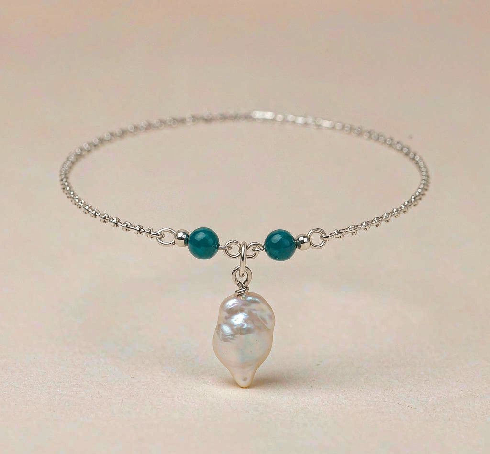
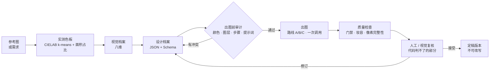
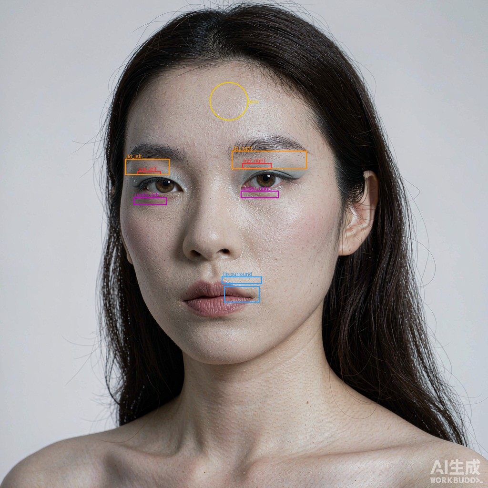
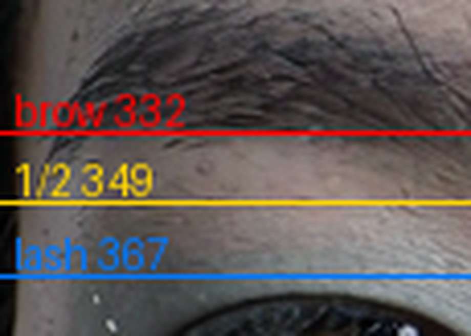
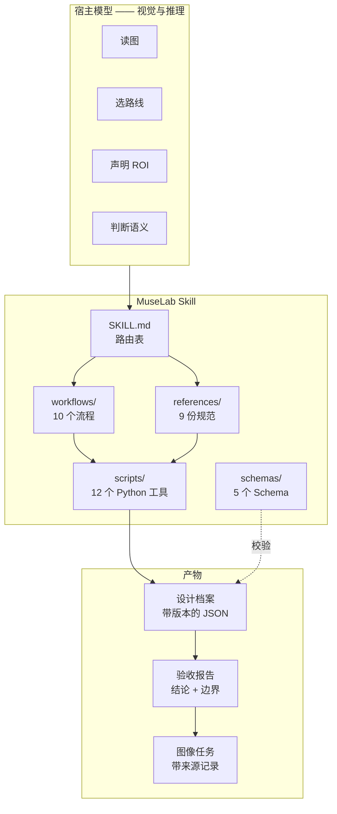

<div align="center">

# MuseLab｜灵感实验室

**Creative Inspiration Lab**

### 从视觉灵感到结构化创意工作流

一张参考图里有颜色、结构和意图，但这些信息几乎无法原样留在手写的提示词里。<br>
MuseLab 先测量图像，再把它写成一份带版本的设计档案，从档案出图，最后拿图去对照档案——
包括如实说出哪些部分它判断不了。

`Python 3.9+` · `WorkBuddy / Claude Skill` · `CIELAB k-means` · `JSON Schema` · `MIT`

**v1.3.1** — 研究原型 · **[English](README.md)** · [演示案例](demos/README.md) · [验证报告](docs/VALIDATION.md)

</div>

<p align="center">
  
  
</p>

<p align="center">
<sub><b>两张都是 AI 生成的概念图，不是真实商品或真人照片。</b><br>
左图水印已裁掉以便排版，带水印原图见 <code>demos/images/03_jewelry_concept_ai.jpg</code>；右图保留宿主工具水印。</sub>
</p>

---

## 一、项目概览

MuseLab 是一套把视觉参考转化成**结构化、可审计创意设计**的模块化工作流。它以 Skill 形态交付——路由表、
JSON Schema、确定性 Python 工具和领域规范，由宿主模型按需加载——目前落地了两个设计领域：**首饰**与**妆容**。

它要解决的问题很具体。AI 做设计通常从一张图开始、到一张图结束，中间那一段——照片里到底是什么颜色、
现在哪一版才是当前版本、出图有没有照着要求来——全靠文字描述，而文字会失真、会过期。MuseLab 在这一段
放了一份机器可读的设计档案，于是每个问题都有一个能被检查的答案。

| | 核心能力 | 做什么 |
|---|---|---|
| **01** | **视觉分析 Visual Analysis** | 测真实像素：CIELAB k-means 色板，每个色簇带面积占比；再加八维视觉档案。每个数值要么是实测，要么明确标为估算。 |
| **02** | **创意转化 Creative Translation** | 把数据变成领域设计档案——首饰的结构与材料清单，或九层妆容与上妆步骤——并过 JSON Schema 校验。 |
| **03** | **生成约束与验证 Controlled Generation** | 从档案出图，每次改动都留版本；**出图前**先审档案有没有自相矛盾，出图后再检查结果。 |

**MuseLab 不是什么。** 它不是绘图工具，也不是提示词合集——绘图模型只是依赖，这个项目做的是它两侧的工作。
它同样不是一个自主 Agent 或多智能体平台：模型负责判断，脚本负责测量，谁也不替对方背书。

## 二、为什么做 MuseLab

AI 辅助设计里，同样三个坑反复出现。MuseLab 按顺序回应这三件事。

| 问题 | 具体会怎样 | MuseLab 的做法 |
|---|---|---|
| **参考图从未被真正测量** | 颜色靠描述而不是采样。同一张图，两个人给出两套色板，都不可复现。 | 在 CIELAB 空间对真实像素做 k-means，每个色簇都带面积占比。测不了就写 `visual_estimate`，不把猜测升级成测量。 |
| **设计活在文字里** | 改到第三版，没人知道哪段是当前的。提示词改了，图层描述没改。 | 带版本的 JSON 档案是唯一事实来源，提示词由它派生，漂移能被检出（`prompt-sync --check`）。定稿版本不可改写。 |
| **没人拿输出对照意图** | 图看着合理就发了——于是照片里本来没有的那颗珠子进了商品目录。 | 每次出图都给一份验收报告：通过了什么、没通过什么，以及代码判不了、必须交给人或视觉模型的清单。 |

### 为什么是 Skill，为什么这样分工

这个项目里最小的工作单位是**判断**：走哪条出图路线、某个偏差是光质问题还是材质问题、这块区域到底可不可测。
这些需要带视觉的模型，一张表单做不了。而能钉死的部分——测色、alpha 合成、Schema 校验、色彩算术、版本控制
——是 Python，并且有测试覆盖。

所以架构是刻意分开的：

- **宿主模型做判断**：读图、选路线、声明 ROI、判断语义。
- **脚本做测量**：12 个确定性工具，不联网、不调模型。
- **设计档案是两边的契约**：模型写它，脚本校验并给它版本，审计查它是否自相矛盾，提示词从它派生。

也是因为这个分工，MuseLab 做成 Skill 而不是网页应用：同一套测量代码可以服务首饰、妆容和下一个模块，
而视觉判断留在本来就有视觉能力的模型那里。

### 质量闭环

```
草稿 ──► 选定 ──► 定稿 ──► 出图 ──► 检查
  ▲        │        │                  │
  └────────┴─ 修订 ─┴──── 新版本 ◄──────┘
```

两条不变量贯穿全程：

- **定稿版本不可变。** 修订产生 N+1 版，带 `change_request` 与 `parent_version`；历史只追加，旧版本永远可读。
- **检查不许宣布超出它测量的东西。** 每份验收报告都带 `needs_human_or_vision` 清单和
  `automation_boundary` 区块，写明哪些是机器判的。

偏差同样被记录。一次出图偏离了设计，它会变成一个版本、一条 `change_request` 和一份 QA 报告，而不是一个
被删掉的文件夹。

## 三、核心能力

### 01 · 视觉分析

色板是下游一切的基础，所以它靠测量而不是靠描述。像素转到 CIELAB 后聚类，每个色簇给出 hex、L\*C\*h\* 坐标
和它在画面中的面积占比。在参考图集上，5 个已知色块全部命中，面积占比也在容差内。

八维视觉档案补上颜色给不了的东西：明度范围、彩度、冷暖比、对比跨度、构图、纹理、氛围词。两份输出都过
Schema，也都能区分实测与估算。

→ `scripts/color_extract.py` · `workflows/visual-analysis.md` · `references/visual-analysis.md`

### 02 · 创意转化

色板不是设计。转化要套用领域规范——首饰的结构与材料可行性，妆容的层次、位置与克制——并把结果写成
程序能检查的档案。档案里的每个颜色都必须能追溯到实测色板，否则就要作为"有意的偏离"显式声明并写明理由。

正是这种可追溯性让后面的审计成立：未申报的颜色是一条发现，而不是一个审美分歧。

→ `workflows/jewelry-design.md` · `workflows/makeup-design.md` · `schemas/design-spec.schema.json`

### 03 · 生成约束与验证

"受约束"指的是约束被写下来、被版本化、被检查，**不是**指图像模型一定会遵守。工作流能保证的是偏差会被
发现并归因，而不是偏差不会发生——正因如此，输出才可迭代，而不只是"看起来合理"。

三条出图路线，各自能承诺的东西不一样：

| 路线 | 机制 | 能承诺什么 |
|---|---|---|
| **A · 实拍合成** | 真实抠图（Vision alpha）→ 像素完整性校验的合成 | 保留区域的原始像素受校验；整体准确性仍受蒙版质量限制 |
| **B · 创意生成** | 由设计档案驱动的文生图 | 概念图可信；结构与物体数量**不保证** |
| **C · 参考图编辑** | 基于参考图的图像编辑 | 换背景与光质并保留主体——实测最弱的一条：它会凭空补齐画外结构 |

路由是能力感知的。宿主没有图像工具时，流程降级为"分析 + 可直接复制的提示词"，并如实说明，而不是假装出了图。

### 六个实现亮点

| 亮点 | 它解决什么问题 |
|---|---|
| **模块化 Skill 架构** | 一套测量内核，多个设计领域。加一个模块是加规则和 Schema，不是重写流程。 |
| **像素级吸色** | 把"这大概是什么颜色"从对话里去掉。色板自带方法、面积占比和 CIELAB 坐标。 |
| **结构化设计规格** | 让设计变成可校验、可 diff、可版本化的数据——后面所有检查的前提。 |
| **版本控制与提示词同步** | 消掉"提示词过期"这一类 bug。`image_prompt` 由 `generation.prompt` 派生，手改镜像会被审计判错。 |
| **跨字段一致性审计** | 在花掉一次出图额度之前，抓住"concept 说的和图层相反"和"这个颜色从没申报过"。 |
| **图像质量评估** | 把"我看着还行"换成数字和阈值——同时把拒绝打分的项目交还给人。 |

## 四、工作流



| 步骤 | 发生什么 | 对应位置 |
|---|---|---|
| 1 · 输入 | 图片或文字需求进入项目 | `muselab_state.py project-init` |
| 2 · 测量 | 色板与视觉档案；实测与估算始终分开标注 | `color_extract.py` |
| 3 · 设计 | 套用领域规范，产出过 Schema 的设计档案 | `workflows/*-design.md` |
| 4 · 审计 | 跨字段矛盾、漂移、改动范围 | `makeup_spec_audit.py --strict` |
| 5 · 出图 | 一条路线、一次调用、不静默重试 | 宿主图像工具 |
| 6 · 检查 | 结论，以及这项检查判不了的全部内容 | `fidelity_check.py` · `makeup_check.py` · `pixel_integrity.py` |
| 7 · 复核 | 人工或视觉模型接手脚本拒绝打分的项目 | — |
| 8 · 修订 | 新版本携带 `change_request`；定稿版本永不就地修改 | `muselab_state.py revise` |

### 一份设计档案，而不是一段散文

```json
{
  "design_id": "mk_beach_tidal",
  "design_category": "makeup",
  "current_version": 13,
  "approval_status": "generated",
  "module_payload": {
    "palette": {
      "measured": [{ "hex": "#E5E2E0", "area_ratio": 0.331, "role": "primary" }],
      "designed": [{ "area": "eyeshadow", "hex": "#9FB8B6" }]
    },
    "layers": {
      "eyeshadow": { "main": "#9FB8B6 单色从睫毛根向上晕至眼窝 1/2，眼尾不加宽", "lower_lid": "省略" }
    },
    "generation": { "route": "creative_generation" }
  }
}
```

*（节选，为可读性删减了字段；数值取自 v13 档案。）*

因为"眼影止于可见上睑的一半、下睑完全不画"这条约束是和颜色写在一起的数据，出图后的检查可以直接测量它，
而不必围着"看起来有点高"争论。

## 五、应用案例

### 案例 01 · 首饰：从一张海滩照片到受约束的商品概念图

一张海滩航拍变成色板，色板变成三款手串设计，其中一款出图，再拿它自己的规格去判它。

<p align="center">
  
</p>

<p align="center">
  
</p>

<p align="center"><sub><b>上：</b>实测色板与每个色簇的面积占比——真正从照片进入设计的只有这份数据。
<b>下：</b>QA 叠加，标出门禁的取样位置；底图是 AI 生成的。原始参考照片不随仓库分发，
测试套件使用的合成输入见 <code>demos/README.md</code>（D1）。</sub></p>

**设计目标**：做一组三件套手串，颜色来自照片而不是来自偏好，同时把结构与材料约束到"可被检查"的程度。

**工作流产出了什么**：三份过 Schema 的设计档案（`jw_beach_A/B/C`），含结构、材料清单、图层描述、提示词与
负向提示词；其中一款走到出图。

**门禁量到了什么**：背景 ΔE 24.4，规格要求 ≤6（米色布面替掉了无缝中性灰）；结构、珠子数量、材质类型都在
容差内；青绿色宝石比设计值暗了 9–10 L\*。将颜色偏差与结构偏差分别识别、分类处理，避免将不同类型的问题
混为一谈，这是质量检查流程的重要价值。

**迭代经验**：另一个商品保真测试故意给了模型一张被画框裁掉的手串照片。它把循环闭合了——凭空补出画外那段、
多加了 2 颗珠、重画了扣和蝴蝶。任何颜色阈值都抓不到这种情况，这也是验收报告里必须有
`needs_human_or_vision` 的原因。

→ 完整案例（D2、D3、D4）：[`demos/README.md`](demos/README.md)

### 案例 02 · 妆容：一套九层妆容，三版迭代收紧了范围

一份海岸色板变成九层妆容设计，含上妆步骤与结构化提示词；每一版都用设计自己的数字去量，量出来的
结果写下下一版。

**设计目标**：九层妆容里每个颜色都能追溯到实测色板，位置写成可测量的描述（"从睫毛根向上晕至眼窝 1/2"），
而不是形容词。

<p align="center">
  
  
</p>

<p align="center"><sub>两张都是 AI 生成。左：v11——眼影铺满整条上睑。右：v13，以及检查实际测量的 ROI 框。</sub></p>

- **v11 立住了妆效，也暴露出范围问题**：右眼爬升 0.93，眼影铺满整条上睑，下眼睑也带了色。档案里还留着
  一句描述 v1 浓妆的 `concept`。
- **v12 改写文字**，审计也顺势补上了 concept / 提示词矛盾检查——检查是从具体观察里长出来的。
- **v13 过了审计（E 0 / W 0）**：爬升收到 0.31/0.32，下睑色素 0.0%。色相是剩下的差距——226°/237° 对设计值
  192°，彩度 1.8–3.0 对 C≈9，是灰蓝而不是灰青。两轮改提示词措辞都没能把它拉回来，这也是路线图把参考图
  路线排在最前的原因。

提示词单一来源的问题也是在这里暴露的：`image_prompt` 自 v8 起一直停在 v1 的旧文案，和它本该描述的图层互相矛盾。
现在它由 `generation.prompt` 派生，手改镜像会被审计判错。

→ 完整案例（D5、D6）：[`demos/README.md`](demos/README.md)

### 这些数字是怎么来的

<p align="center">
  
</p>

<p align="center"><sub>诊断裁切：画出眉下缘、可见上睑中点与睫根三条参考线，于是"晕到眉下了"可以被核对，而不是靠吵。AI 生成人脸。</sub></p>

QA 报告里的每个数字都对应一块声明过的 ROI。流程里没有面部关键点库，ROI 由人或视觉模型声明——`--capabilities`
如实输出 `available: []` 与 `roi_source: human_or_vision_declared`，不暗示自己在做检测。ROI 放错照样会给出
看起来很确定的数字：有一次把框放到海面上，它依然判了 `consistent`。

## 六、架构与技术栈



**确定性层（Python，有测试）**：测色、alpha 合成、像素完整性比对、蒙版审计与修补、门禁算术、档案审计、
项目状态与版本。12 个脚本，不联网、不调模型。

**判断层（宿主模型）**：读图、选出图路线、声明 ROI、判断偏差是否可接受、撰写设计档案本身。

| 技术栈 | 用途 |
|---|---|
| Python 3.9+ | 全部确定性工具 |
| Pillow ≥ 10、numpy ≥ 1.24 | 图像读写、CIELAB 转换、k-means、像素运算 |
| `jsonschema`（可选） | 严格 Schema 校验；缺失时回落到必填字段检查 |
| `pyobjc-framework-Vision`（可选，macOS 14+） | 原生 alpha 抠图；否则走 PIL 回退 |
| JSON Schema | 模型与脚本之间的设计档案契约 |
| Markdown + Mermaid | 流程、规范、本文档 |

```
SKILL.md              宿主模型先读的路由表
workflows/            10 个分步流程
references/           9 份领域规范 + 完整 CLI 参考
schemas/              5 个 JSON Schema
scripts/              12 个确定性工具 + requirements.txt
tests/                run_tests.py、夹具生成器、18 个夹具、RESULTS.md
demos/                6 个案例 + 14 张精选图
docs/                 验证状态、安全扫描、发布清单
```

## 七、快速开始

```bash
git clone https://github.com/yiliabuilds/muselab.git
cd muselab
python3 -m pip install -r scripts/requirements.txt
python3 scripts/check_env.py        # 本机有哪些能力
python3 tests/run_tests.py          # 90 项，约 60 秒
```

建议先跑 `check_env.py`：它会报告原生抠图、严格 Schema 校验和图像工具是否可用，流程会沿着这些能力降级，
而不是跑到一半才失败。

### 作为 Skill 使用

```bash
cp -r muselab ~/.workbuddy/skills/muselab          # 用户级
# 或 <项目>/.workbuddy/skills/muselab               # 项目级
```

技能按描述被加载——没有服务端、没有常驻进程、自身不需要 API Key。视觉与出图由宿主提供。

### 前五条命令

```bash
# 1. 从参考图测一份色板
python3 scripts/color_extract.py --image ref.jpg --k 8 --json palette.json --swatch palette.png

# 2. 建项目、登记设计
python3 scripts/muselab_state.py project-init  --dir work/proj
python3 scripts/muselab_state.py design-add    --dir work/proj --file design.json

# 3. 确认无误再定稿
python3 scripts/muselab_state.py design-approve --dir work/proj --id jw_a --version 1 --consent

# 4. 花掉出图额度之前先审妆容档案（有 error 即退出 7）
python3 scripts/makeup_spec_audit.py --project work/proj --design mk_tidal --strict

# 5. 保证提示词只有一个来源（漂移则退出 6）
python3 scripts/muselab_state.py prompt-sync --dir work/proj --check
```

出图由宿主模型发起：它调用一次图像工具，再用 `task-add` / `task-done` 记录结果，让来源信息始终挂在对应的
设计版本上。

## 八、开发与验证

**当前阶段。** MuseLab 是一个研究原型。确定性部分——测色、Schema 校验、版本管理、跨字段审计、像素完整性
——已经实现，并由下面的测试覆盖。真实出图仍是正在打磨的一环：色彩与细节在不同出图之间的一致性还在迭代，
每一张的测量结果都如实记录，不做四舍五入式的乐观处理。逐张细节见
[`docs/VALIDATION.md`](docs/VALIDATION.md)。

```
PASS 83 | FAIL 0 | NOT-RUN 7 | ENV-UNSUPPORTED 0 | total 90
```

测试套件离线运行约一分钟；7 项 NOT-RUN 逐条写明了原因，**一律不计入通过**。

| 项目 | 结果 |
|---|---|
| **自动化测试** | 83 PASS · 0 FAIL · 7 NOT-RUN · 0 ENV-UNSUPPORTED（共 90 项） |
| **真实出图** | 三个项目共 4 次 ImageGen 调用，每次都有验收报告；色彩与细节一致性仍在迭代 |
| **门禁起了什么作用** | 4 次都抓到了具体偏差；其中 3 次直接产出了档案或提示词的修正 |
| **妆容参考图路线** | 尚未跑通端到端（需要真实面部照片与编辑能力） |
| **身份保真** | 现有工具无法自动验证，每份妆容报告都标为 `not_code_testable` |

验收报告做的是把测量和判断分开：背景超规格 ΔE 24.4，同时宝石暗 9–10 L\*；模型把画框外的结构补齐；
上睑带覆盖到整条上睑。这些拆分最后变成了版本、`change_request` 和审计规则——同一批证据，读作迭代输入，
而不是一个分数。

### 哪些属于 Beta

| 领域 | 阈值依据 |
|---|---|
| 上睑带检查（覆盖率、爬升、三信号平衡） | 4 张合成夹具 + 2 张真实出图标定；内双与肿眼泡未覆盖 |
| 下睑镜面反光检测 | 只记录、不判失败——天然卧蚕高光与珠光带在像素上几乎同形 |
| 档案审计词典 | 词典 + 结构比对：能抓"说反了"，抓不到"换个说法" |
| 门禁色彩模型 | 去光照补偿只在合成色偏上验证过 |

### 完全无法自动判定的部分

审美、这套妆是否适合这个人、两种不同措辞是否语义等价、身份保真。它们出现在 `needs_human_or_vision` 里，
而不是变成一个分数。

→ 完整报告：[`docs/VALIDATION.md`](docs/VALIDATION.md) · 原始记录：[`tests/RESULTS.md`](tests/RESULTS.md)

## 九、已知限制

1. **没有面部关键点库。** 所有 ROI 由人或视觉模型声明，框错了照样会给出看起来很确定的数字。
2. **低彩度目标的色相保真是当前的主要问题。** 妆容出图会偏 35–45°，落到相邻色族；单靠改提示词没有推动它，
   参考图路线是下一步。
3. **档案审计是词典 + 结构比对，不是语义理解。** 能抓矛盾，抓不到改写。
4. **左右平衡受光照干扰。** ΔE 含 L\*，主光不对称会被读成上妆不对称。报告会写明这一点，而不是硬下结论。
5. **合成准确性受蒙版质量限制。** `pixel_integrity.py` 校验的是保留像素没被重绘、没被裁切，**不是**抠图是否完整
   ——有一个用例里蒙版漏掉 1,305 px 商品，像素完整性仍返回 `pass_exact`。
6. **身份保真无法验证。** 现有工具做不到。
7. **生成图带宿主工具水印。** 不能当作成品商品摄影使用。
8. **穿搭设计、IP 衍生品设计、虚拟试戴都不存在。** 只有扩展契约（`references/module-extension.md`）；
   `workflows/virtual-try-on.md` 是规范，不是实现。

## 十、路线图

**v1.3.x 已实现**：吸色与色板、八维视觉档案、首饰设计、妆容设计、三条出图路线、带像素完整性的实拍合成、
带不可改写定稿的设计状态机、跨字段审计、上睑/下睑/唇部检查、提示词单一来源与漂移检测。

**下一步，尚未开始**


---

## 许可与图片说明

MIT，见 [LICENSE](LICENSE)。开发期使用的参考照片**未随仓库分发**——来源无法核实，所以只保留由它们导出的色板
与测量结果。`demos/images/` 中的每张出图都是 AI 生成并已标注；两张人脸图是生成人物，不是真人。
细节见 [`docs/SECURITY-SCAN.md`](docs/SECURITY-SCAN.md)。

<p align="center"><sub><a href="README.zh-CN.md">简体中文</a> · <a href="README.md">English</a> · <a href="demos/README.md">演示案例</a> · <a href="docs/VALIDATION.md">验证报告</a> · <a href="docs/PUBLISH-MANIFEST.md">发布清单</a></sub></p>
