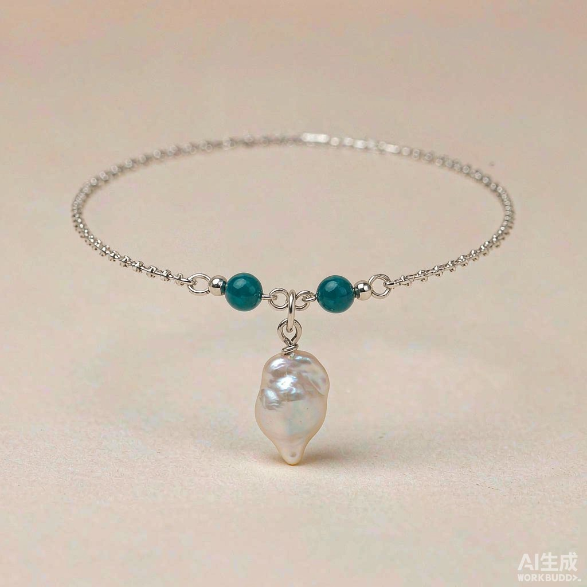
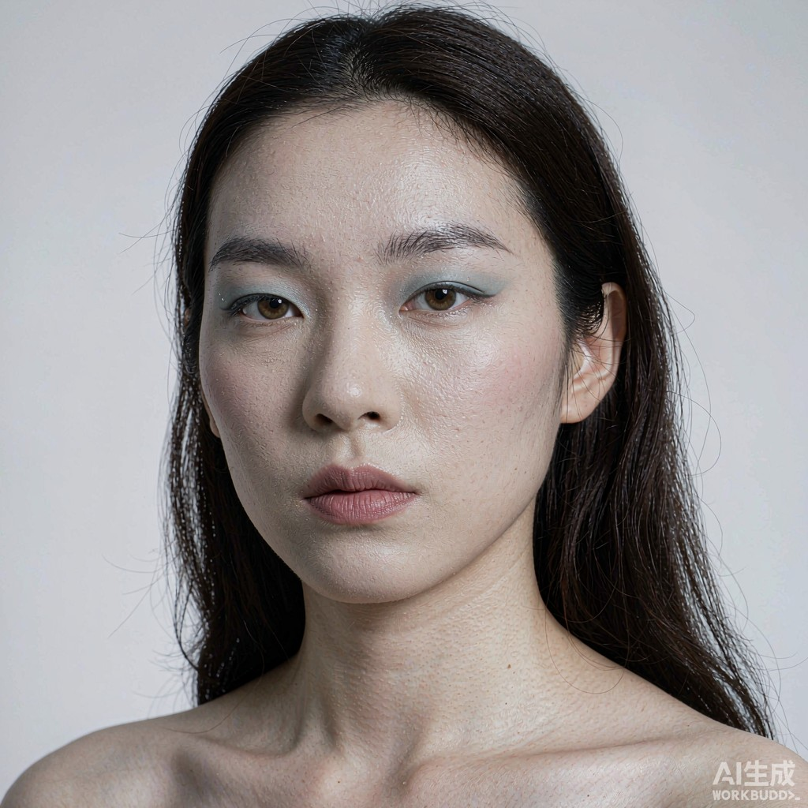

# MuseLab｜灵感实验室

**模块化 AI 视觉创意工作流 — Creative Inspiration Lab**

MuseLab 把一张参考图变成可机器读取的设计档案，再在约束下出图，然后检查出图是否真的遵守了档案。
它以 **Skill** 形态实现：路由表 + JSON Schema + 确定性 Python 工具 + 领域设计规范，由宿主模型按需加载。

它不是绘图工具，也不是提示词合集。绘图模型只是依赖；这个仓库做的是它两侧的工作——把像素变成
可测量的数据，把数据变成设计规格，再验证出图有没有照着规格来。

```
参考图 ─► 实测色板 ─► 结构化设计 ─► 受约束出图 ─► 质量验收
        (CIELAB k-means)   (Schema + 版本)   (三条路线之一)   (代码 + 人工)
```

**当前状态：v1.3.1，公开前的原型。** 首饰与妆容两个模块已实现并真实出过图；穿搭与 IP 衍生品模块
**尚未实现**（见[路线图](#十路线图)）。真实出图的验收通过率为 0/4，这个数字在
[验证](#八验证与测试)里解释，而不是被藏起来。

---

## 一、项目概述

多数"AI 做设计"的失败都发生在同样三个地方：

1. **参考图从未被真正测量。** 颜色来自对图片的描述，而不是图片本身。同一张图，两个人给出两套色板。
2. **设计活在散文里。** 改到第三版，没人知道哪一段是当前的；提示词改了，图层描述没改。
3. **没人拿输出对照意图。** 图看起来合理就发了——于是照片里本来没有的那颗珠子进了商品目录。

MuseLab 按这个顺序回应这三件事：每个设计事实要么是实测的，要么被明确标注为估算；每套设计是一份
带版本的 JSON 档案，不是一段文字；每次出图之后都有一次检查，并写清它能判什么、不能判什么。

### 为什么做成 Skill 而不是网页

工作的最小单位是**判断**——走哪条出图路线、某个偏差是材质错还是光照、这块区域到底可不可测。
这些需要带视觉的模型，而不是一张表单。确定性的部分（测色、alpha 合成、Schema 校验、色彩算术、
版本控制）是 Python，并且有测试。这个分工是刻意的：**模型做判断，脚本做测量，两边都不许替对方背书。**

## 二、核心功能

| # | 功能 | 状态 |
|---|---|---|
| 1 | 模块化 Skill 架构，按能力在三条出图路线间路由 | 已实现 |
| 2 | 像素级吸色（CIELAB k-means，实测面积占比，实测与估算可区分） | 已实现，有测试 |
| 3 | 八维视觉分析 → 领域设计规范（首饰、妆容） | 已实现 |
| 4 | 结构化设计档案：JSON Schema、版本状态机、定稿版本不可改写 | 已实现，有测试 |
| 5 | 跨字段一致性审计（色板 ↔ 图层 ↔ 步骤 ↔ 提示词 ↔ concept） | 已实现，有测试 |
| 6 | 图像质量门禁（背景规格、色相/材质分离、像素完整性、蒙版审计） | 已实现，合成图 + 1 张真实图验证 |
| 7 | 妆容专项检查（上睑覆盖率与爬升、三信号左右平衡、下睑色素 vs 镜面、唇缘） | 已实现，阈值属 Beta |
| 8 | 提示词单一来源 + 派生镜像 + 漂移检测（`prompt-sync`） | 已实现，有测试 |
| 9 | 实拍合成路线：真实抠图 → 像素完整性校验的合成，不经过生成模型 | 已实现，有测试 |
| 10 | 穿搭设计、IP 衍生品设计、虚拟试戴 | **未实现** |

## 三、架构

```
┌──────────────────────────────────────────────────────────────────────┐
│ 宿主模型（视觉 + 推理）                                                │
│   读图 · 选路线 · 声明 ROI · 判断语义                                  │
└───────────────┬──────────────────────────────────────────────────────┘
                │ SKILL.md 路由表
    ┌───────────┴────────────┬─────────────────┬──────────────────┐
    ▼                        ▼                 ▼                  ▼
workflows/               references/       schemas/           scripts/
视觉分析                 首饰规范          设计档案            color_extract
吸色                     妆容规范          妆容档案            cutout / compose
首饰设计                 摄影标准          图像任务            pixel_integrity
妆容设计                 色彩理论          视觉档案            mask_audit
系列设计                 API 参考          项目状态            fidelity_check
出图路线                 模块扩展                              makeup_check
虚拟试戴（仅规范）                                             makeup_spec_audit
                                                              muselab_state
```

**确定性层（Python，有测试）**：测色、alpha 合成、像素完整性比对、蒙版审计与修补、门禁算术、
档案审计、项目状态与版本。12 个脚本，不联网、不调模型。

**判断层（宿主模型）**：读图、选出图路线、声明 ROI、判断偏差是否可接受、撰写设计档案本身。

**两层的契约**是那份 JSON 设计档案：模型写它，脚本校验并给它版本，审计查它内部是否自相矛盾，
提示词从它派生。

### 三条出图路线

| 路线 | 机制 | 能承诺什么 |
|---|---|---|
| **A. 实拍合成** | 真实抠图（Vision alpha）→ 像素完整性校验的合成 | 保留区域的原始像素受到校验；整体准确性仍受蒙版质量限制 |
| **B. 创意生成** | 由设计档案驱动的文生图 | 概念图可信；结构与数量**不保证** |
| **C. 参考图生成** | 基于参考图的图像编辑 | 换背景/光质且保留主体——**实测最弱**：它凭空补齐了画外结构 |

路由是能力感知的：宿主没有图像工具时，流程降级为提示词交付并如实说明，而不是假装出图。

## 四、工作流

```
1  输入      图片或需求
2  测量      色板（k-means）、八维视觉档案 —— 实测与估算始终分开标注
3  设计      领域规范 → 设计档案（JSON），过 Schema
4  审计      makeup_spec_audit.py --strict（跨字段矛盾、漂移、改动范围）
5  出图      路线 A/B/C，一次调用，不静默重试
6  检查      fidelity_check.py · makeup_check.py · pixel_integrity.py → 结论 + 判不了什么
7  复核      人工/视觉检查脚本拒绝打分的项目
8  修订      新版本带 change_request；定稿版本永不就地修改
```

两条不变量贯穿全程：

- **定稿版本不可变。** 修订产生 N+1 版，带 `change_request` 与 `parent_version`；历史只追加。
- **检查不许宣布超出它测量的东西。** 每份门禁报告都带 `needs_human_or_vision` 与
  `automation_boundary`。

## 五、安装

要求：Python 3.9+、Pillow ≥ 10、numpy ≥ 1.24。可选：`jsonschema`；macOS 14+ 上可用
`pyobjc-framework-Vision` 走原生抠图。

```bash
git clone <this-repo> MuseLab
cd MuseLab
python3 -m pip install -r scripts/requirements.txt
python3 scripts/check_env.py            # 报告本机有哪些能力
python3 tests/run_tests.py              # 90 项，约 60 秒
```

作为 WorkBuddy / Claude Skill 使用，把目录放进技能目录：

```bash
cp -r MuseLab ~/.workbuddy/skills/muselab     # 用户级
# 或 <项目>/.workbuddy/skills/muselab          # 项目级
```

技能按描述被加载；没有服务端、没有常驻进程、自身不需要 API Key。视觉与出图由宿主提供。

## 六、使用示例

### 测色板

```bash
python3 scripts/color_extract.py --image ref.jpg --k 8 --json palette.json --swatch palette.png
```

`palette.json` 会写明 `method: pixel_kmeans`、每个簇的 CIELAB 与 hex、以及各自的像素占比。
测不了时方法会变成 `visual_estimate`——它不会把猜测悄悄升级成测量。

### 登记设计并出图

```bash
python3 scripts/muselab_state.py project-init --dir work/proj
python3 scripts/muselab_state.py design-add   --dir work/proj --file design.json
python3 scripts/muselab_state.py design-select --dir work/proj --id jw_a --version 1
python3 scripts/muselab_state.py design-approve --dir work/proj --id jw_a --version 1 --consent
# 宿主动用图像工具调用一次，然后：
python3 scripts/muselab_state.py task-add  --dir work/proj --design-id jw_a --file task.json
python3 scripts/muselab_state.py task-done --dir work/proj --task-id img_1 --path out.png --tool ImageGen
```

### 出图前先审妆容档案

```bash
python3 scripts/makeup_spec_audit.py --project work/proj --design mk_tidal --strict
# 有 error 即退出 7：未申报色值、concept 残留、提示词/镜像漂移、越界改动
```

### 检查出图（ROI 由人或视觉模型声明）

```bash
python3 scripts/makeup_check.py --config gate.json --json qa.json --overlay qa.png
python3 scripts/fidelity_check.py --config gate_jewelry.json --json qa_jewelry.json
```

### 维护提示词单一来源

```bash
python3 scripts/muselab_state.py prompt-sync --dir work/proj --check   # 漂移则退出 6
python3 scripts/muselab_state.py prompt-sync --dir work/proj           # 生成同步版本
```

## 七、演示案例

完整案例（输入、工作流、输出、状态、偏差）见 [`demos/README.md`](demos/README.md)。

| 案例 | 展示什么 | 状态 |
|---|---|---|
| 像素 → 色板 | 5/5 已知色块命中，带方法与面积占比 | 已验证 |
| 色板 → 首饰设计 | 一套色板产出三份合规档案 | 已验证（状态机）；设计好坏属人工判断 |
| 首饰概念出图 | 门禁抓到背景不合规（ΔE 24.4），同时放行结构 | **验收未通过** |
| 商品保真 | 模型凭空补齐画外结构、多加了 2 颗珠 | **未通过**——最有价值的一次失败 |
| 妆容 v11 → v13 | v11 带着残留的 `concept` 出图，而当时的审计只读色值；v12 改写文字，v13 审计 E 0 / W 0 通过、色相照样漂移 | **两次都未通过**——v11 卡在范围，v13 卡在色相 |
| QA 叠加图 | 数字从哪来；为什么"晕到眉下"是误读 | 作为工具已验证 |

<p align="center">
  
  
</p>

*两张图均为 **AI 生成**并带宿主工具水印，是概念效果图，不是真实商品或真人照片。*

## 八、验证与测试

```
PASS 83 | FAIL 0 | NOT-RUN 7 | ENV-UNSUPPORTED 0 | total 90
```

- **NOT-RUN 一律不计入通过。** 7 项需要图像工具、出图额度、真实面部照片或联网搜索，逐项写明了原因。
- **真实出图单独统计。** 三个项目共 4 次 ImageGen 调用，**没有一次通过验收**；四次偏差都被门禁抓到。
- **阈值标定范围如实写出。** 上睑阈值来自 4 张合成夹具 + 2 张真实出图——够用，但不足以声称普适。

哪些结论是 Beta、哪些尚未验证：[`docs/VALIDATION.md`](docs/VALIDATION.md)。

## 九、已知限制

1. **没有面部关键点库。** 所有 ROI 由人或视觉模型声明；`--capabilities` 会如实输出
   `available: []` 与 `roi_source: human_or_vision_declared`。ROI 放错照样会给出看起来很确定的数字
   ——曾把"眼睛"框到海面上，仍判出一致（Δhue 9.7°）。
2. **档案审计是词典 + 结构比对，不是语义理解。** 能抓"concept 说反了"，抓不到"换了个说法"，
   也抓不到它词典没覆盖的旧措辞。
3. **低彩度目标的色相保真差。** 两次妆容出图稳定偏 35–45°，落到错误的色族；改提示词无效，
   参考图路线尚未验证。
4. **左右平衡受光照干扰。** ΔE 含 L\*，主光不对称会被读成上妆不对称。报告会写明这一点，而不是硬下结论。
5. **身份保真无法验证。** 现有工具做不到，每份妆容报告都把它列为 `not_code_testable`。
6. **生成图带宿主工具水印。** 不能当作成品商品摄影发布。
7. **穿搭与 IP 衍生品模块不存在。** 只有扩展契约（`references/module-extension.md`）。
8. **合成准确性受蒙版质量限制，而像素完整性只查其中一部分。** `pixel_integrity.py` 校验的是
   保留像素没被重绘、没被裁切，**不是**抠图是否完整。03i 就是证据：蒙版漏掉 1,305 px 商品，
   `mask_audit` 判 `review`，而 `pixel_integrity` 对它看得见的像素仍返回 `pass_exact`。
   像素完整性通过 ≠ 合成干净。

## 十、路线图

**已实现（v1.3.x）**：吸色与色板、视觉档案、首饰设计、三条出图路线、带像素完整性的实拍合成、
设计状态机、跨字段审计、妆容模块（上睑/下睑/唇）、提示词单一来源与漂移检测。

**下一步（尚未开始）**
- 妆容参考图路线——最有可能修正色相漂移的一次改动。
- 面部关键点适配层（可选依赖，缺失时回落到声明式 ROI）。
- 眼镜 / 包袋模块。
- 多图系列的系列级一致性。
- 用感知指标（SSIM/LPIPS）替代 Laplacian 能量来衡量纹理保留。

**当前明确不做**：穿搭设计、IP 衍生品设计、虚拟试戴、自主多智能体编排。它们最多以接口约定的形式
出现在 `workflows/` 里，不得被描述成已有功能。

## 目录结构

```
SKILL.md              宿主模型先读的路由表
workflows/            分步流程（10）
references/           领域规范与完整 CLI 参考（9）
schemas/              5 个 JSON Schema
scripts/              确定性工具（12）
tests/                run_tests.py、夹具生成器、夹具、RESULTS.md
demos/                对外演示案例与图片
docs/                验证状态、安全扫描、发布清单
```

## 许可

MIT，见 [LICENSE](LICENSE)。开发期使用的参考照片未随仓库分发。
